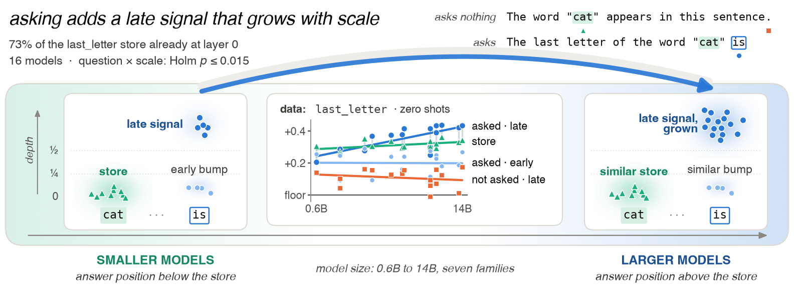

# Character Information in Language Models: A Prompt-Independent Word Store and a Late, Question-Driven Signal That Grows With Scale

Code and data for the paper by Pratyush Acharya, Nuraj Rimal, Apar Baral, Habish Dhakal and
Piyush Mohan Bhattarai.

Linear probes recover character properties of a word (its first, last or most frequent letter) from
a language model's hidden states. This repository separates two sources of that signal across 16
open-weight models (0.6B–14B, seven families):

- a **word-level store**: the property is decodable from the query word's own tokens in a sentence
  that asks nothing, largely already in the token embedding, and roughly constant across scale;
- a **late, question-driven signal** at the answer position, present only when the property is
  asked for, confined to the second half of the network, and the only part that grows with scale.



The paper is in [`paper/`](paper/) ([PDF](paper/main.pdf)).

## Main results

- The query word's own tokens encode `first_letter`, `last_letter` and `most_frequent_letter` above
  a word-only nuisance floor in all 16 models; about 70% of that signal is already in the token
  embedding, consistent with prior work.
- The question − no-question difference at the answer position grows with model size for all four
  prompt-sensitive tasks (Holm-corrected permutation p ≤ 0.016, also within model families). The
  growth is confined to layers past half depth; in the first quarter of the network the slope is
  indistinguishable from zero.
- Small models' answer positions hold less linearly decodable information than their word-level
  store; large models' hold more. What produces the excess is not identified.
- Several controls change what can be claimed: word-only floors, count tasks rebuilt to remove
  length, repetition and query-letter shortcuts, a logit-scale readout check, and a pre-registered
  stem-order test whose prediction failed. All are reported in the paper.

## Repository layout

```
scripts/                 experiment runners, analysis and figure/table generation
  run_v4_suite.sh        runs every GPU stage, then the CPU analysis (resumable)
  run_stage1.py          core library: task construction, extraction, held-out-word probes
  run_wordpos.py         word position vs answer position, three prompt arms (+ stem-order test)
  run_grid.py            question arm: probes, readout, answer-token subspace, free generation
  run_crosstask.py       probe property A while the prompt asks property B
  run_review.py          single- vs multi-token split and MLP probes (not used in the paper)
  analyze_v4.py          main analysis (floors, store, interaction, readout, cross-task)
  analyze_v4_followups.py  layer-band, crossing-depth and stem-order analyses
  analyze_v4_review.py   analysis for run_review.py
  make_paper_v4.py       generates every table and figure in paper/ from outputs/
  check_paper_drift.py   compares a paper revision with an earlier one (numbers, wording)
  models.txt             the 16 Hugging Face model identifiers
src/                     model loading, hooks, and the 6000-word stimulus list
outputs/                 all result files behind the paper (about 8 MB, JSON)
paper/                   LaTeX source, generated figures and tables (exact values in Appendix D),
                         claims ledger (CLAIMS.md) and citation audit
```

## Setup

```bash
uv sync          # Python >= 3.11; versions are pinned to those that produced the results
```

Llama-3.x and Gemma-2 are gated: accept their licenses on Hugging Face and put `HF_TOKEN` in
`.env.deploy` (see [`.env.example`](.env.example)).

## Reproduce the paper's numbers from the included results (CPU, minutes)

```bash
uv run python scripts/analyze_v4.py              # writes outputs/v4/analysis/summary.{json,md}
uv run python scripts/analyze_v4.py --estimator peak
uv run python scripts/analyze_v4_followups.py    # outputs/v4/analysis/followups.{json,md}
uv run python scripts/make_paper_v4.py           # paper/tables/*.tex and paper/figures/*.pdf
cd paper && pdflatex main && bibtex main && pdflatex main && pdflatex main
```

The analysis is deterministic: outputs are identical across runs and Python hash seeds. Every
number in the paper's figures and tables is computed by `make_paper_v4.py` from `outputs/`.

`paper/main.tex` has a double-blind switch: set `\anonymoustrue` to remove the author block, email
and code link. To check a revision of the paper against an earlier version, run
`uv run python scripts/check_paper_drift.py --baseline <git ref>`; it lists every number that does
not trace to the earlier paper or to `outputs/`, every dropped number, and wording that
`paper/CLAIMS.md` rules out.

## Re-run the experiments (GPU)

All runs used one 48 GB GPU in bf16. The full suite is about 60 GPU-hours.

```bash
bash scripts/run_v4_suite.sh --dry-run                       # list the jobs
bash scripts/run_v4_suite.sh                                 # smoke test, then every stage
bash scripts/run_v4_suite.sh --stages wordpos,analyze        # one stage
bash scripts/run_v4_suite.sh --remote user@host --stages ... # sync to a GPU host, run in tmux
bash scripts/run_v4_suite.sh --pull                          # fetch results back
```

Every job skips outputs that already exist, so an interrupted run resumes by repeating the command.
Stages: `smoke`, `wordpos` (word vs answer position), `grid` (question arm, readout, subspace),
`crosstask`, `crosstask_term`, `analyze`, and the opt-in `stemorder` and `review`.

## Measurement choices

- **Held-out words.** Probes use three-fold cross-validation grouped by query word.
- **Held-out layer selection.** For each test fold, the layer is chosen on the other folds.
- **Word-only nuisance floors.** Every probe is compared with predictors that see only the word's
  length, letter set and query letter (`analyze_v4.py`).
- **Deterministic sampling.** Examples are drawn from `src/stimulus_words.txt` with seed 42,
  iterating letters in sorted order.
- **Pre-registered criteria.** Decision criteria and outcomes are listed in Appendix B of the paper.

## Data files

| Directory | Contents |
|---|---|
| `outputs/v4/wordpos/` | Word- and answer-position probes, three prompt arms, 16 models × 3 task sets × 2 shot counts |
| `outputs/v4/stemorder/` | Stem-order test (question before vs after the word) |
| `outputs/v4/crosstask/` | Cross-task control, primary and term-label arms |
| `outputs/bigstim_v4_grid/` | Question-arm probes and readout (`gate_*`), answer-token subspace (`align_*`), free generation (`drop_*`) |
| `outputs/bigstim_stage1_gate_grouped{,_cvs}/` | Preliminary-estimator runs, used for the estimator check in Appendix A.4 |
| `outputs/v4/analysis/` | Analysis summaries and nuisance floors |

## Citation

```bibtex
@article{acharya2026charstore,
  title   = {Character Information in Language Models: A Prompt-Independent Word Store
             and a Late, Question-Driven Signal That Grows With Scale},
  author  = {Acharya, Pratyush and Rimal, Nuraj and Baral, Apar and Dhakal, Habish
             and Bhattarai, Piyush Mohan},
  journal = {arXiv preprint},
  year    = {2026}
}
```

## License

Code is released under the [MIT License](LICENSE).
